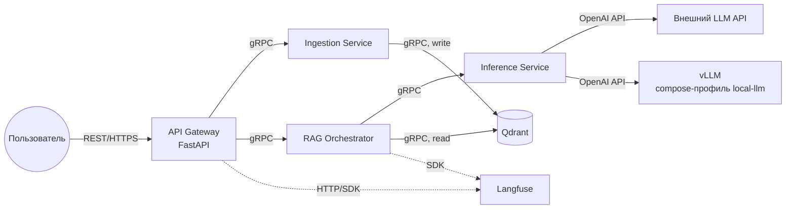

# Проект: Личный RAG-бот с расширяемыми источниками данных и подключаемым инференсом

<details>
<summary>Промпт</summary>

Делаем брейншторм.
Я хочу написать личного чат бота с помощью RAG, который будет подниматься в докер контейнере локально на моей видеокарте NVIDIA GeForce RTX 3070 8192MiB. Его знания должны базироваться на векторной базе данных (для упрощения пока тоже локальной) - в отдельном контейнере, первоначально я хочу ее сформировать из моего ноушена, но нужно оставить возможность добавлять и обновлять данных, не ограничиваясь только ноушеном. На данный момент все должно быть локально на уровне докер контейнеров и оркестратора над ними (можно просто скриптом все поднимать, можно docker compose, можно кубер, тут подумай и предложи варинаты, которые в дальнейшем смогут масшабирваться (из локального в дц, делать несколько инстансов тех или иных подов и тд) - я пока больше склоняюсь к куберу).
Первый шаг - это формирование векторной бд из исходных данных. Как я сказал для начала берем только ноушен - должен быть скрипт/бинарь который по конфигу аунтификации автоматически соскрапит все доступные ему документы из ноушена. В дальнейшем будет расширяться список источников сбора данных - все это должно одним скриптом производится динамически отключая и включая нужные источники исходя из того, если ли соответсвующие креды (token, API Keys, etc). Во время скрапинга нужно формировать векторную базу данных. Тут нужно подумать каким алгоритмом/фреймвокром/моделью это делать. У меня на примете: llamaindex, SBERT (мб llamaindex как раз что-то похожее и использует). Т е нужно понимать как мы документы разрезаем на чанки, формируем эмбединги (каким алгоритмом) и тд.
На этапе работы первый проход - это сформировать эбмединг пропмта и по нему найти несколько релевантых документом (сколько обычно тут берут чанков?), далее должен быть бертовский реканкер который переранжирует найденные документы и еще точнее их отфильтрует. Т е по сути два фильтра: векторный поиска по бд (быстрый но менее точный - берем побольше и грубой прикидкой достаем хоть какие-то релевантные) и реранкер (который помощьнее, но тяжелее с точки зрения перфа, поэтому и работает не со все базой, а только с релевантным документами - их кол-во уже не такое большое, что-то аля Берт cross-encoder). первый фильтр bi encoder, второй фильтр cross encoder.
Далее с формируется промп (тут нужно решить как, с помощью jinja? или есть другие подходы: лучше/хуже?) куда вставляется пользовательский запрос и релевантные документы. Этот промпт передается дальше в базовую модель. Напоминаю, основное условие, чтобы эта модель запускалась на моей NVIDIA GeForce RTX 3070 8192MiB хотя бы на инференс (а в идеале еще чтобы можно было дообучить с помощью LoRA, но это уже не обязательное условие - давай обсудим, насколько оно достижимо и стоит ли заморачиваться, т к обучающей выборки у меня нет - но мб ее можно сгенерировать синтетически с помощью тут уже API других моделей). Т е модель должна быть open source, а не просто через API, и подниматься локально через какой-нибудь движок инференса типо vLLM, SGLang, TRTLLM, etc - тут надо тоже подумать и решить какой брать. Хотя решение должно расширяться вплоть до запуска флагманских open source тяжелых моделей на нескольких GPU.
Ну и собственно нужно отдавать ответ пользователю. На этом этапе должен подниматься сервис на опеределенном порту с ручками типо хэслчека, сгенерируй ответ и тд. Нужно дать возможность управлять через API параметрами модели и самого RAG (если вообще так можно, условно, ограничивать кол-во документов на первом и втором фильтрах и тд).
UI на данном этапе не нужен, также пока все должно быть локально в docker контейнера + оркестратора над ними.
Также нужно продумать возможность прикрутить judge для нашей модельки (judge уже должне по API подключаться), чтобы оценить работу модели по сути без ground truth данных.
Нужно продумать на чем мы будем строить сам RAG: langchain, langgraph (он кажется тут избыточен но мб я и не прав), llamaindex (может ли он построить полноценный RAG без langchain?), 
Также мне кажется, что контейнеры тут лучше декомпозировать (разбить на несколько компонент): отдельно с векторной бд, отдельно с моделькой (чтобы локальную инсталяцию можно было легко подменять на API для тестов - да и в целом чтобы можно было работать без локальной инсталяции моделки - это скорее опция) и сам RAG (ему как раз можно задавать в конфигурации куда ходить за бд и моделью). Давай тут подумаем и обсудим.
Еще нужно подумать нужен ли нам Langfuse. По сути это вроде как мониторинг, но я не оч понимаю к чему именно его лучше прикручивать (пока выглядит будто бы к RAG компоненте).
Наверное, я бы первый заход делал без локальной инсталяции модели а использовал бы внешний API. Сделал бы работающий вариант RAG + бд, а потом бы уже прикручивал локальную инсталяцию.

</details>

> **Прогресс:** статус выполнения шагов ведётся в [progress.md](./progress.md). При работе над любым шагом обновляй его статус там (правила — в шапке трекера); при добавлении/изменении шагов синхронизируй оба документа.

## 1. Описание проекта

Разрабатывается система личного чат-бота на основе **Retrieval-Augmented Generation (RAG)** в виде набора микросервисов в Docker-контейнерах. Первичная разработка и тестирование выполняются локально (тестовый стенд — машина с NVIDIA GeForce RTX 3070, 8 ГБ VRAM), но архитектура не привязана к конкретному железу: инференс должен работать в любом из режимов — внешний API, CPU, потребительская GPU, серверные GPU (A100/H200, мульти-GPU).

Система должна обеспечивать:

- Сбор данных из внешних источников через расширяемую систему адаптеров. Первый адаптер — **локальные файлы**, следующий — **Notion**, далее любые сервисы с данными (Google Drive, iCloud и т.д.).
- Построение и инкрементальное обновление векторной базы данных (Qdrant, отдельный контейнер).
- Двухступенчатый поиск релевантных документов: быстрый bi-encoder (векторный поиск) и точный cross-encoder (реранкер).
- Генерацию ответа через **отдельный сервис инференса**, который за единым интерфейсом умеет либо хостить открытую LLM локально (vLLM), либо работать прокси к внешнему API (OpenAI, Anthropic и т.д.) — переключение не меняет интерфейс для остальной системы.
- Единую пользовательскую точку входа — **API Gateway** (асинхронный FastAPI с REST API). Пользователь общается только с ним; внутренние сервисы между собой общаются по **gRPC**.
- Мониторинг и оценку качества (опционально: Langfuse и LLM-as-a-judge).
- Холодный старт без данных: весь ансамбль сервисов поднимается и до первого ингеста; пока данные не инициализированы, запросы генерации отклоняются явной ошибкой (см. раздел 2.4).

Проект должен быть масштабируемым: начальная реализация на Docker Compose, архитектура должна позволять переход на Kubernetes для горизонтального масштабирования.

## 2. Архитектура и компоненты

Система состоит из следующих микросервисов (каждый в своём контейнере):

1. **API Gateway** — единственный пользовательский вход в систему. Асинхронный FastAPI с REST API: генерация ответа, запуск/статус ингеста, передача кредов источников, healthcheck всей системы. Внутрь транслирует запросы по gRPC. Запрос генерации до инициализации данных отклоняется явной ошибкой «данных нет» (см. раздел 2.4).
2. **Ingestion Service** — постоянно работающий gRPC-сервис (не одноразовый скрипт). Принимает через API креды внешних источников (в защищённом виде, см. раздел 2.3), скрапит данные через адаптеры, выполняет чанкинг и генерацию эмбеддингов, пишет в векторную БД. Долгие операции ингеста выполняются как асинхронные задачи (job) с отслеживанием статуса.
3. **Vector Database** — Qdrant. Нативно поддерживает и REST (порт 6333), и gRPC (порт 6334); используем gRPC через официальный python-клиент (`prefer_grpc=True`).
4. **RAG Orchestrator** — gRPC-сервис с бизнес-логикой: эмбеддинг запроса, двухступенчатый поиск (bi-encoder → cross-encoder), формирование промпта, вызов Inference Service.
5. **Inference Service** — gRPC-фасад над генерацией. Внутри инкапсулирует провайдера: `proxy` (внешний OpenAI-совместимый API) или `local` (локальный vLLM-контейнер). Остальная система про провайдера не знает.
6. **Monitoring (опционально)** — Langfuse для трассировки и оценки. Важно: Langfuse предоставляет HTTP API и собственный веб-UI, gRPC у него нет; сервисы интегрируются с ним через SDK/HTTP, а Gateway при необходимости может отдавать агрегированный статус.

### 2.1 Схема взаимодействий



- Пользователь напрямую видит только API Gateway.
- Gateway не ходит в Inference Service и в Qdrant напрямую.
- gRPC-контракты (`.proto`) лежат в отдельной директории `proto/` и являются единым источником правды; код клиентов/серверов генерируется из них.

### 2.2 Inference Service: провайдеры и тяжёлый образ vLLM

Ключевое решение: сам Inference Service — всегда **лёгкий** образ (gRPC-сервер + OpenAI-совместимый HTTP-клиент, без ML-зависимостей). vLLM не встраивается в него, а поднимается **отдельным контейнером** (официальный образ `vllm/vllm-openai`) только когда нужен:

- `INFERENCE_PROVIDER=proxy` → vLLM-контейнер не поднимается вообще, Inference Service ходит на внешний API.
- `INFERENCE_PROVIDER=local` → docker-compose профиль `local-llm` поднимает vLLM, Inference Service ходит на него.

Оба варианта скрыты за одним gRPC-интерфейсом `Generate(prompt, params)` — RAG Orchestrator не меняется при переключении. Такой дизайн решает проблему «тяжёлой библиотеки, когда она не нужна», и упрощает замену движка (SGLang, TRT-LLM) в будущем.

Этот же дизайн даёт задел на горизонтальное масштабирование: Inference Service — stateless, поэтому его можно реплицировать без изменений кода, поставив перед репликами L7-балансировщик с поддержкой gRPC (Envoy/nginx; в Kubernetes — стандартный Service + gRPC-aware балансировка). Аналогично масштабируется и слой vLLM: так как общение с ним идёт по обычному OpenAI-совместимому HTTP, несколько vLLM-инстансов (на разных GPU/узлах) прячутся за роутером, а Inference Service по-прежнему знает лишь один базовый URL. Единственная точка конфигурации — адрес балансировщика вместо адреса конкретного инстанса, так что переход от одной реплики к N не затрагивает остальные сервисы.

Важно, что для LLM-инстансов наивный round-robin неоптимален: запросы сильно различаются по стоимости (длина промпта/генерации), а vLLM держит prefix/KV-кэш в VRAM — выгодно направлять запросы с общим префиксом (у нас это системный промпт и повторяющиеся RAG-шаблоны) на одну и ту же реплику. Поэтому на этапе масштабирования вместо «глупого» балансировщика перед vLLM ставится LLM-aware роутер, учитывающий попадание в prefix-кэш и текущую загрузку реплик (глубина очереди, число активных запросов): готовые варианты — vLLM Production Stack router, llm-d, AIBrix, Kubernetes Gateway API Inference Extension. Для самого Inference Service достаточно обычной gRPC-балансировки — состояния и кэша у него нет.

### 2.3 Передача и хранение кредов источников

Креды (Notion token, Google API keys и т.д.) передаются в систему через ручку Gateway и доставляются в Ingestion Service. Подход по этапам:

- **Первый заход (обязательно):** TLS на входе в Gateway; креды передаются per-request при запуске ингеста, живут только в памяти Ingestion Service на время задачи и не персистятся. Это самый простой и безопасный вариант. Загрузка данных при этом не привязана к старту системы — ингест запускается в любой момент после подъёма сервисов (см. раздел 2.4).
- **Когда появится периодический ингест:** хранение кредов в Ingestion Service в зашифрованном виде at rest (AES-GCM/Fernet, мастер-ключ из переменной окружения / docker secret).
- **Опциональное усиление:** клиент шифрует креды публичным ключом Ingestion Service (гибридная схема), так что даже Gateway видит только шифротекст.
- **Kubernetes-этап:** переход на Vault/KMS или Sealed Secrets.

### 2.4 Холодный старт: система поднимается без данных

Загрузка данных не является условием старта: весь ансамбль сервисов поднимается «пустым», а ингест запускается позже через API. Поведение до инициализации данных:

- Пока не завершился хотя бы один успешный ингест, запрос генерации отклоняется: RAG Orchestrator возвращает gRPC `FAILED_PRECONDITION`, Gateway маппит её в HTTP-ошибку с явным сообщением «данные не инициализированы» (409/503). Ручки ингеста, статуса и healthcheck при этом работают как обычно.
- Признак «данные инициализированы» нельзя держать в памяти сервиса — при рестарте он потеряется. Источник правды — персистентное состояние в Qdrant (данные лежат в volume и переживают рестарты), никаких in-memory флагов. Проверку выполняет RAG Orchestrator — он единственный, кто читает Qdrant; Gateway в Qdrant по-прежнему не ходит.
- Чтобы не отличать «частично залитую» коллекцию от готовой, признаком завершённого ингеста служит служебный маркер, который Ingestion Service записывает в Qdrant по успешному завершению первого job (а не сам факт появления точек в коллекции).

### 2.5 Инструменты

- **FastAPI** — REST API в Gateway.
- **gRPC (grpcio + protobuf)** — межсервисное взаимодействие.
- **LlamaIndex** — чанкинг и работа с документами в Ingestion Service.
- **Sentence Transformers** — эмбеддинги (bi-encoder) и реранкер (cross-encoder, например `BAAI/bge-reranker-base`).
- **qdrant-client** — доступ к Qdrant по gRPC.
- **vLLM** — локальный инференс LLM (отдельный контейнер, по профилю).
- **Jinja2** — шаблоны промптов.
- **Docker / Docker Compose (с профилями)** — контейнеризация.

Примечание: LangChain из обязательного стека исключён — при явной микросервисной декомпозиции оркестрация в RAG Orchestrator пишется простым Python-кодом (embed → search → rerank → prompt → generate), дополнительный фреймворк здесь избыточен. Вернуться к нему можно, если появятся сложные цепочки/агенты.

### 2.6 Требования к железу

- Система не привязана к конкретному GPU. Матрица режимов инференса: внешний API (GPU не нужен вовсе) → CPU / потребительская GPU (7B в 4-bit на 8 ГБ VRAM, контекст до 4096) → серверные GPU и мульти-GPU (A100/H200, tensor parallelism в vLLM).
- Тестовый стенд первого захода — RTX 3070 (8 ГБ): 7B-модель в 4-bit (AWQ/GPTQ) укладывается в VRAM.
- Эмбеддинги и реранкер могут работать на CPU; на GPU — опционально (разделение через `CUDA_VISIBLE_DEVICES`).

### 2.7 Сквозные требования ко всем сервисам

- **Независимый запуск:** для каждого сервиса — debug-скрипт внутри его модуля (`<service>/scripts/run_debug.sh`), поднимающий его отдельно (вместе с минимальными зависимостями) для локальной отладки без всего «зоопарка». Корневой `scripts/` — только для управления системой целиком.
- **Тестируемость:** unit-тесты на бизнес-логику + интеграционные тесты на gRPC/REST-интерфейсы (для gRPC удобно тестировать и вручную через `grpcurl`).
- **Логирование:** каждый сервис пишет в stdout и в собственный файл (volume). Централизованное хранение/агрегация логов — позже, на этапе мониторинга.
- **Конфигурация:** через переменные окружения (`.env`), у каждого сервиса свой префикс.

## 3. Этапы реализации (план работ)

### Этап 0: Подготовка окружения и инфраструктуры

**Шаг 0.1:** Установка Docker и Docker Compose; NVIDIA Container Toolkit (нужен только для профиля `local-llm`).

**Шаг 0.2:** Создание структуры репозитория. Принцип: каждый сервис — самодостаточный модуль (код, тесты, Dockerfile, свои скрипты — всё внутри его директории); в корне лежит только то, что шарится между модулями (proto, общие конфиги) и то, что управляет системой целиком (docker-compose/K8s, скрипты запуска всего ансамбля):
```
ragneda/
├── docker-compose.yml      # управление ансамблем целиком
├── proto/                  # gRPC-контракты (единый источник правды, шарится между сервисами)
│   ├── ingestion.proto
│   ├── rag.proto
│   └── inference.proto
├── gateway/                # API Gateway (FastAPI)
│   ├── Dockerfile
│   ├── src/
│   ├── tests/
│   └── scripts/            # debug-запуск этого сервиса (run_debug.sh)
├── ingestion/              # Ingestion Service (gRPC)
│   ├── Dockerfile
│   ├── src/
│   ├── tests/
│   └── scripts/
├── rag_orchestrator/       # RAG Orchestrator (gRPC)
│   ├── Dockerfile
│   ├── src/
│   ├── tests/
│   └── scripts/
├── inference/              # Inference Service (gRPC, лёгкий)
│   ├── Dockerfile
│   ├── src/
│   ├── tests/
│   └── scripts/
├── scripts/                # только общесистемное: запуск/останов ансамбля, кодогенерация из proto
└── configs/                # общие конфиги (окружения docker-compose/Kubernetes)
```

**Шаг 0.3:** docker-compose.yml с сервисами `gateway`, `ingestion`, `rag_orchestrator`, `inference`, `qdrant`; профили: `local-llm` (vLLM), `monitoring` (Langfuse). Сети, volumes (данные Qdrant, кэш HuggingFace, файлы логов), переменные окружения.

**Шаг 0.4:** Настроить общий тулинг: генерация gRPC-кода из `proto/` (makefile/скрипт), линтеры, pytest, каркасы debug-скриптов.

---

### Этап 1: gRPC-контракты

**Шаг 1.1:** Описать `.proto` для всех внутренних сервисов:
- `ingestion.proto` — `TriggerIngest(source, credentials, options) → job_id`, `GetJobStatus(job_id)`, `ListSources()`.
- `rag.proto` — `GenerateAnswer(query, retrieval_params, generation_params) → answer + used_chunks`.
- `inference.proto` — `Generate(prompt/messages, params) → text`, `Health()`.

**Шаг 1.2:** Настроить кодогенерацию клиентов/серверов и подключить сгенерированный код в каркасы сервисов. Health-check у каждого сервиса — стандартный gRPC Health Checking Protocol.

---

### Этап 2: Vector Database (Qdrant)

**Шаг 2.1:** Поднять Qdrant, проверить доступность веб-UI (6333) и gRPC (6334).

**Шаг 2.2:** Написать smoke-скрипт, который через `qdrant-client` (gRPC) создаёт тестовую коллекцию, пишет и читает вектора. Qdrant — внешняя компонента без собственного модуля в репозитории, поэтому скрипт живёт в корневом `scripts/` как общесистемная проверка инфраструктуры. Это же — основа интеграционного теста.

---

### Этап 3: Ingestion Service (первый адаптер — локальные файлы)

**Шаг 3.1:** Каркас gRPC-сервиса с job-моделью: `TriggerIngest` ставит асинхронную задачу, `GetJobStatus` отдаёт прогресс/результат/ошибку.

**Шаг 3.2:** Абстракция источников: интерфейс `DataSource` (`fetch()` → документы с метаданными: источник, заголовок, URL/путь, дата). Реестр/фабрика адаптеров: адаптер активируется, если для него переданы креды или конфиг. Добавление нового источника = новый адаптер, без изменения остального кода.

**Шаг 3.3:** Первый адаптер — **локальные файлы**: чтение из примонтированной директории (.txt, .md, .pdf, .docx). Кредов не требует — удобен для отладки всего пайплайна.

**Шаг 3.4:** Пайплайн обработки:
- Чанкинг через LlamaIndex (`SentenceSplitter`, `chunk_size=512`, `chunk_overlap=100`), метаданные чанка (источник, заголовок, номер чанка).
- Эмбеддинги через `SentenceTransformer` (например, `intfloat/multilingual-e5-small`), кеширование для повторных запусков.

**Шаг 3.5:** Запись в Qdrant по gRPC: коллекция `documents`, размерность по модели, в `payload` — текст чанка и метаданные. `upsert` по детерминированным ID (источник + документ + номер чанка) для инкрементальных обновлений. По успешному завершению job записывать в Qdrant служебный маркер «данные инициализированы» (раздел 2.4).

**Шаг 3.6:** Приём кредов: поле `credentials` в `TriggerIngest`, стартовая схема безопасности из раздела 2.3 (TLS + только в памяти на время задачи).

**Шаг 3.7:** Debug-скрипт `ingestion/scripts/run_debug.sh` (поднимает Qdrant + Ingestion) и вызов ингеста через `grpcurl`/тестовый gRPC-клиент. Тесты: unit на чанкинг/фабрику адаптеров, интеграционный на полный ингест локальной директории.

---

### Этап 4: Inference Service (провайдер proxy)

**Шаг 4.1:** Каркас gRPC-сервиса с интерфейсом из `inference.proto`. Внутри — абстракция `InferenceProvider` с реализациями `OpenAIProxyProvider` (первым) и `LocalVLLMProvider` (позже, этап 8). Выбор — через `INFERENCE_PROVIDER`.

**Шаг 4.2:** Реализовать `OpenAIProxyProvider`: асинхронный клиент к OpenAI-совместимому API (`httpx`), проброс параметров генерации (temperature, max_tokens), обработка ошибок и таймаутов.

**Шаг 4.3:** Debug-скрипт `inference/scripts/run_debug.sh` + проверка `Generate` через `grpcurl`. Тесты с моком внешнего API.

---

### Этап 5: RAG Orchestrator

**Шаг 5.1:** Каркас gRPC-сервиса, реализация `GenerateAnswer`. В начале обработки — проверка инициализации данных по персистентному маркеру в Qdrant (раздел 2.4): если данных нет, возвращать `FAILED_PRECONDITION`, не доходя до поиска и генерации.

**Шаг 5.2:** Эмбеддинг запроса той же моделью, что при индексации (загрузка один раз при старте).

**Шаг 5.3:** Первый фильтр (bi-encoder): векторный поиск в Qdrant по gRPC, `top_k` чанков (default 50).

**Шаг 5.4:** Второй фильтр (cross-encoder): реранкер (`BAAI/bge-reranker-base` или `cross-encoder/ms-marco-MiniLM-L-6-v2`), скоринг пар (запрос, чанк), отбор `rerank_top_n` лучших (default 5).

**Шаг 5.5:** Формирование промпта через Jinja2-шаблон: системная инструкция + контекст из чанков (с номерами и источниками) + запрос пользователя.

**Шаг 5.6:** Вызов Inference Service по gRPC. Оркестратор ничего не знает о провайдере (local/proxy) — эта логика инкапсулирована в Inference Service.

**Шаг 5.7:** В ответе возвращать сгенерированный текст и использованные чанки (для отладки). Персистентное хранение этой отладочной информации — позже, на этапе мониторинга.

**Шаг 5.8:** Логирование каждого запроса/ответа в stdout + файл сервиса.

**Шаг 5.9:** Debug-скрипт `rag_orchestrator/scripts/run_debug.sh` (Qdrant + Inference + Orchestrator), тесты: unit на промпт/реранкинг, интеграционный на полный цикл с моком инференса.

---

### Этап 6: API Gateway

**Шаг 6.1:** Асинхронное FastAPI-приложение с REST-роутами:
- `GET /health` — агрегированный статус всех внутренних сервисов (по их gRPC health-checks).
- `POST /generate` — `{"query": str, "top_k": int, "rerank_top_n": int, "temperature": float, "max_tokens": int}` → ответ + использованные чанки. Проксируется в RAG Orchestrator.
- `POST /ingest` — запуск ингеста: источник, опции, креды (см. раздел 2.3) → `job_id`. Проксируется в Ingestion Service.
- `GET /ingest/{job_id}` — статус задачи ингеста.
- `GET /sources` — список доступных адаптеров источников.

**Шаг 6.2:** Асинхронные gRPC-клиенты к Ingestion и RAG Orchestrator (`grpc.aio`), маппинг ошибок gRPC в HTTP-коды. В том числе `FAILED_PRECONDITION` от RAG Orchestrator → HTTP 409 с явным сообщением «данные не инициализированы, запустите ингест» (раздел 2.4).

**Шаг 6.3:** TLS/базовая аутентификация на входе (хотя бы API-key), т.к. Gateway — единственная точка, доступная пользователю.

**Шаг 6.4:** Сквозная проверка: на «пустой» системе `POST /generate` возвращает 409 «данные не инициализированы»; затем через REST Gateway запустить ингест тестовой директории локальных файлов, дождаться завершения job, после чего `POST /generate` даёт осмысленный ответ (провайдер proxy). Отдельно проверить рестарт сервисов после ингеста — признак инициализации сохраняется. Тесты: интеграционные на REST-эндпоинты, включая сценарий «до ингеста».

---

### Этап 7: Адаптер Notion

**Шаг 7.1:** Реализовать `NotionDataSource` на официальном SDK: по токену получить доступные страницы и базы, конвертировать в Markdown/текст с метаданными (заголовок, URL, дата).

**Шаг 7.2:** Зарегистрировать адаптер в фабрике; токен приходит per-request через `POST /ingest`.

**Шаг 7.3:** Запустить через API ингест небольшой выборки из Notion, проверить корректность векторов и метаданных в Qdrant, инкрементальный `upsert` при повторном запуске.

---

### Этап 8: Локальный инференс через vLLM

**Шаг 8.1:** Выбрать модель под тестовый стенд: `mistralai/Mistral-7B-Instruct-v0.2` или `meta-llama/Meta-Llama-3-8B-Instruct` в 4-bit (AWQ/GPTQ).

**Шаг 8.2:** Добавить в compose сервис `vllm` (образ `vllm/vllm-openai`) под профилем `local-llm`:
```
--model <model_name> --dtype half --max-model-len 4096 --enforce-eager --gpu-memory-utilization 0.9
```
Примонтировать кэш HuggingFace. Без профиля образ не тянется и контейнер не поднимается.

**Шаг 8.3:** Реализовать `LocalVLLMProvider` в Inference Service (тот же OpenAI-совместимый клиент, но эндпоинт `http://vllm:8000/v1`). Переключение `INFERENCE_PROVIDER=local` — без изменений в остальных сервисах.

**Шаг 8.4:** Проверить доступность vLLM (`/v1/models`), прогнать полный цикл через Gateway на локальной модели, убедиться в отсутствии OOM.

**Шаг 8.5:** Нагрузочное тестирование (последовательные/параллельные запросы), при необходимости тюнинг `--max-num-seqs`, `--max-num-batched-tokens`.

---

### Этап 9: Мониторинг и оценка (Langfuse + Judge)

**Шаг 9.1:** Поднять Langfuse под compose-профилем `monitoring`. Интеграция через SDK (HTTP): RAG Orchestrator трассирует каждый запрос (запрос, найденные чанки, промпт, ответ).

**Шаг 9.2:** Реализовать judge: асинхронная отправка (запрос, контекст, ответ) внешней модели для оценки по критериям (релевантность, полнота, корректность), сохранение оценок в Langfuse.

**Шаг 9.3:** Организовать персистентное хранение отладочных данных запросов (чанки, промпты) — то, что до этого только возвращалось в ответе и писалось в файловые логи.

**Шаг 9.4:** При необходимости — эндпоинт в Gateway с агрегированной статистикой (Langfuse gRPC не предоставляет, поэтому Gateway ходит в него по HTTP).

---

### Этап 10: Расширение источников и автоматизация ингеста

**Шаг 10.1:** Адаптер Google Drive (Google Drive API); далее — прочие источники по мере надобности (iCloud и т.д.) — каждый как новый `DataSource`.

**Шаг 10.2:** Периодический ингест (scheduler внутри Ingestion Service или внешний cron, дергающий API). На этом шаге внедрить шифрованное хранение кредов at rest (раздел 2.3).

**Шаг 10.3:** Дедупликация и удаление: обработка удалённых из источника документов (очистка соответствующих точек в Qdrant).

---

### Этап 11: Оптимизация и подготовка к масштабированию (Kubernetes)

**Шаг 11.1:** Профилирование узких мест (поиск, реранкинг, генерация): GPU для реранкера или уменьшение `top_k`, кеширование эмбеддингов частых запросов, при нехватке VRAM — модель меньше (Phi-3-mini) или `max-model-len` 2048.

**Шаг 11.2:** Kubernetes-манифесты (Deployment, Service, Ingress для Gateway, PersistentVolume для Qdrant). gRPC-архитектура ложится на K8s естественно (headless services, балансировка gRPC).

**Шаг 11.3:** Горизонтальное масштабирование: Qdrant — кластерный режим; Gateway и RAG Orchestrator — несколько реплик; vLLM — несколько инстансов и/или мульти-GPU (tensor parallelism) для тяжёлых моделей.

**Шаг 11.4:** Секреты через Vault/KMS/Sealed Secrets; инфраструктурный мониторинг (Prometheus + Grafana): GPU, задержки, ошибки.

---

## 4. Детали конфигурации и переменные окружения

**API Gateway:**
- `INGESTION_GRPC_ADDR` — например, `ingestion:50051`.
- `RAG_GRPC_ADDR` — например, `rag_orchestrator:50052`.
- `GATEWAY_API_KEY` — ключ для аутентификации входящих запросов.
- `LANGFUSE_HOST` — если используется мониторинг.

**Ingestion Service:**
- `QDRANT_HOST`, `QDRANT_GRPC_PORT` (6334).
- `EMBEDDING_MODEL` — например, `intfloat/multilingual-e5-small`.
- `CHUNK_SIZE`, `CHUNK_OVERLAP`.
- `LOCAL_FILES_DIR` — директория для адаптера локальных файлов.
- `CREDENTIALS_ENCRYPTION_KEY` — мастер-ключ шифрования кредов at rest (появляется на этапе 10).
- Креды источников (Notion token и т.д.) через env не задаются — передаются через API.

**RAG Orchestrator:**
- `QDRANT_HOST`, `QDRANT_GRPC_PORT`.
- `EMBEDDING_MODEL` — та же модель, что при индексации.
- `RERANKER_MODEL` — например, `BAAI/bge-reranker-base`.
- `INFERENCE_GRPC_ADDR` — например, `inference:50053`.
- `LANGFUSE_PUBLIC_KEY`, `LANGFUSE_SECRET_KEY` — если используется.

**Inference Service:**
- `INFERENCE_PROVIDER` — `proxy` или `local`.
- `LLM_ENDPOINT` — URL OpenAI-совместимого API: внешний либо `http://vllm:8000/v1`.
- `LLM_API_KEY` — ключ внешнего API (для `proxy`).
- `LLM_MODEL` — имя модели у провайдера.

**vLLM (только профиль `local-llm`):**
- `MODEL_NAME` — полное имя модели на HuggingFace.
- `MAX_MODEL_LEN` — 4096.
- Дополнительные флаги — см. документацию vLLM.

---

## 5. Критерии успеха для каждого этапа

- **Этап 0:** Compose поднимает каркасы сервисов; кодогенерация из proto работает.
- **Этап 1:** Контракты описаны, сгенерированный код подключён, health-checks отвечают.
- **Этап 2:** Debug-скрипт пишет и читает вектора в Qdrant по gRPC.
- **Этап 3:** Ингест локальной директории через gRPC создаёт корректные чанки/вектора/метаданные в Qdrant; job-статусы отслеживаются; тесты зелёные.
- **Этап 4:** `Generate` через gRPC возвращает ответ внешнего API; сервис запускается независимо debug-скриптом.
- **Этап 5:** `GenerateAnswer` возвращает осмысленный ответ с использованными чанками на данных из этапа 3; на неинициализированных данных — `FAILED_PRECONDITION`.
- **Этап 6:** Полный пользовательский цикл через REST Gateway: ошибка «данных нет» до ингеста → ингест → статус job → генерация ответа; признак инициализации переживает рестарт.
- **Этап 7:** Ингест из Notion через API работает, повторный запуск делает инкрементальный upsert.
- **Этап 8:** Переключение на локальную модель одной переменной окружения + профилем compose; скорость генерации приемлемая на тестовом стенде (порядка 20 токенов/сек), без OOM.
- **Этап 9:** Трассировки видны в Langfuse, оценки judge записываются.
- **Этап 10:** Новый источник подключается новым адаптером без изменения остального кода; периодический ингест работает, креды хранятся зашифрованными.
- **Этап 11:** Система разворачивается в K8s с несколькими репликами без сбоев.

---

## 6. Рекомендации для AI-агента

- Все сервисы на Python 3.11+ с единым менеджером зависимостей (poetry или uv).
- Код с type hints и docstrings; линтеры и pytest запускаются для каждого сервиса.
- gRPC-код генерируется из `proto/` автоматически, руками не редактируется.
- Конфигурация через `.env` + `python-dotenv`/`pydantic-settings`; в git — только `.env.example`.
- Логирование через `logging`: stdout + файл сервиса.
- Асинхронность везде: `async def` в FastAPI, `grpc.aio` для gRPC, `httpx` для HTTP.
- Для каждого сервиса поддерживать debug-скрипт независимого запуска внутри его модуля (`<service>/scripts/run_debug.sh`); в корневой `scripts/` класть только общесистемные скрипты.
- После завершения каждого шага обновлять его статус в `docs/progress.md` (IN PROGRESS → DONE с датой и заметкой); новые шаги добавлять и в план, и в трекер.

---

## 7. Примечания по производительности и ограничениям

- Тестовый стенд (RTX 3070, 8 ГБ): 7B-модель в 4-bit, контекст 4096, батч из 1 запроса — без OOM. При нехватке памяти: `max-model-len` 2048 или модель меньше (Phi-3-mini). На серверных GPU эти ограничения снимаются (vLLM поддерживает tensor parallelism для мульти-GPU).
- Реранкер — на CPU при нехватке VRAM, на GPU — при возможности.
- Векторный поиск в Qdrant (HNSW): ~10–50 мс на выборку 50 чанков; gRPC-интерфейс быстрее REST на массовых операциях (ингест).
- gRPC между сервисами добавляет минимальный оверхед по сравнению с внутрипроцессными вызовами, но даёт независимое масштабирование и деплой каждой компоненты.
- Кешировать эмбеддинги повторяющихся запросов.

---

## 8. Заключение

План разбит на этапы с чёткими шагами и критериями завершённости. Порядок выстроен так, чтобы каждая компонента была независимо запускаемой и тестируемой, а рабочий сквозной сценарий (локальные файлы + внешний LLM API) появился как можно раньше — локальная модель, Notion и мониторинг подключаются поверх без изменения интерфейсов.
