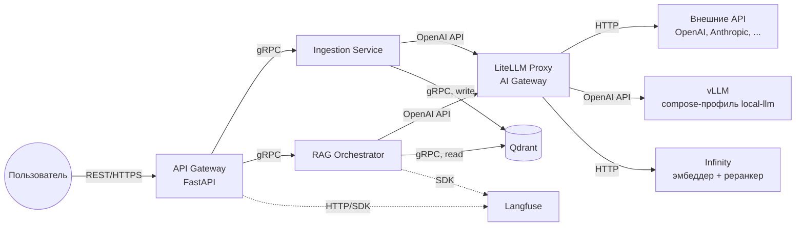

# Проект: Личный RAG-бот с расширяемыми источниками данных и подключаемым инференсом

> **Название:** *ragvalod* — от [Рогволода](https://ru.wikipedia.org/wiki/%D0%A0%D0%BE%D0%B3%D0%B2%D0%BE%D0%BB%D0%BE%D0%B4), князя полоцкого.

---

<details>
<summary>Промпт</summary>

Делаем брейншторм.
Я хочу написать личного чат бота с помощью RAG, который будет подниматься в докер контейнере локально на моей видеокарте NVIDIA GeForce RTX 3070 8192MiB. Его знания должны базироваться на векторной базе данных (для упрощения пока тоже локальной) - в отдельном контейнере, первоначально я хочу ее сформировать из моего ноушена, но нужно оставить возможность добавлять и обновлять данных, не ограничиваясь только ноушеном. На данный момент все должно быть локально на уровне докер контейнеров и оркестратора над ними (можно просто скриптом все поднимать, можно docker compose, можно кубер, тут подумай и предложи варинаты, которые в дальнейшем смогут масшабирваться (из локального в дц, делать несколько инстансов тех или иных подов и тд) - я пока больше склоняюсь к куберу).
Первый шаг - это формирование векторной бд из исходных данных. Как я сказал для начала берем только ноушен - должен быть скрипт/бинарь который по конфигу аунтификации автоматически соскрапит все доступные ему документы из ноушена. В дальнейшем будет расширяться список источников сбора данных - все это должно одним скриптом производится динамически отключая и включая нужные источники исходя из того, если ли соответсвующие креды (token, API Keys, etc). Во время скрапинга нужно формировать векторную базу данных. Тут нужно подумать каким алгоритмом/фреймвокром/моделью это делать. У меня на примете: llamaindex, SBERT (мб llamaindex как раз что-то похожее и использует). Т е нужно понимать как мы документы разрезаем на чанки, формируем эмбединги (каким алгоритмом) и тд.
На этапе работы первый проход - это сформировать эбмединг пропмта и по нему найти несколько релевантых документом (сколько обычно тут берут чанков?), далее должен быть бертовский реканкер который переранжирует найденные документы и еще точнее их отфильтрует. Т е по сути два фильтра: векторный поиска по бд (быстрый но менее точный - берем побольше и грубой прикидкой достаем хоть какие-то релевантные) и реранкер (который помощьнее, но тяжелее с точки зрения перфа, поэтому и работает не со все базой, а только с релевантным документами - их кол-во уже не такое большое, что-то аля Берт cross-encoder). первый фильтр bi encoder, второй фильтр cross encoder.
Далее с формируется промп (тут нужно решить как, с помощью jinja? или есть другие подходы: лучше/хуже?) куда вставляется пользовательский запрос и релевантные документы. Этот промпт передается дальше в базовую модель. Напоминаю, основное условие, чтобы эта модель запускалась на моей NVIDIA GeForce RTX 3070 8192MiB хотя бы на инференс (а в идеале еще чтобы можно было дообучить с помощью LoRA, но это уже не обязательное условие - давай обсудим, насколько оно достижимо и стоит ли заморачиваться, т к обучающей выборки у меня нет - но мб ее можно сгенерировать синтетически с помощью тут уже API других моделей). Т е модель должна быть open source, а не просто через API, и подниматься локально через какой-нибудь движок инференса типо vLLM, SGLang, TRTLLM, etc - тут надо тоже подумать и решить какой брать. Хотя решение должно расширяться вплоть до запуска флагманских open source тяжелых моделей на нескольких GPU.
Ну и собственно нужно отдавать ответ пользователю. На этом этапе должен подниматься сервис на опеределенном порту с ручками типо хэслчека, сгенерируй ответ и тд. Нужно дать возможность управлять через API параметрами модели и самого RAG (если вообще так можно, условно, ограничивать кол-во документов на первом и втором фильтрах и тд).
UI на данном этапе не нужен, также пока все должно быть локально в docker контейнера + оркестратора над ними.
Также нужно продумать возможность прикрутить judge для нашей модельки (judge уже должне по API подключаться), чтобы оценить работу модели по сути без ground truth данных.
Нужно продумать на чем мы будем строить сам RAG: langchain, langgraph (он кажется тут избыточен но мб я и не прав), llamaindex (может ли он построить полноценный RAG без langchain?), 
Также мне кажется, что контейнеры тут лучше декомпозировать (разбить на несколько компонент): отдельно с векторной бд, отдельно с моделькой (чтобы локальную инсталяцию можно было легко подменять на API для тестов - да и в целом чтобы можно было работать без локальной инсталяции моделки - это скорее опция) и сам RAG (ему как раз можно задавать в конфигурации куда ходить за бд и моделью). Давай тут подумаем и обсудим.
Еще нужно подумать нужен ли нам Langfuse. По сути это вроде как мониторинг, но я не оч понимаю к чему именно его лучше прикручивать (пока выглядит будто бы к RAG компоненте).
Наверное, я бы первый заход делал без локальной инсталяции модели а использовал бы внешний API. Сделал бы работающий вариант RAG + бд, а потом бы уже прикручивал локальную инсталяцию.

</details>

---

> **Прогресс:** статус выполнения шагов ведётся в [progress.md](./progress.md). При работе над любым шагом обновляй его статус там (правила — в шапке трекера); при добавлении/изменении шагов синхронизируй оба документа.

## 1. Описание проекта

Разрабатывается система личного чат-бота на основе **Retrieval-Augmented Generation (RAG)** в виде набора микросервисов в Docker-контейнерах. Первичная разработка и тестирование выполняются локально (тестовый стенд — машина с NVIDIA GeForce RTX 3070, 8 ГБ VRAM), но архитектура не привязана к конкретному железу: инференс должен работать в любом из режимов — внешний API, CPU, потребительская GPU, серверные GPU (A100/H200, мульти-GPU).

Система должна обеспечивать:

- Сбор данных из внешних источников через расширяемую систему адаптеров. Первый адаптер — **локальные файлы**, следующий — **Notion**, далее любые сервисы с данными (Google Drive, iCloud и т.д.).
- Построение и инкрементальное обновление векторной базы данных (Qdrant, отдельный контейнер).
- Двухступенчатый поиск релевантных документов: быстрый bi-encoder (векторный поиск) и точный cross-encoder (реранкер).
- Доступ ко **всем** моделям (LLM, эмбеддер, реранкер) через единую точку — **LiteLLM Proxy** (готовый open-source AI gateway): за одним OpenAI-совместимым API скрываются и self-hosted модели (vLLM, Infinity), и внешние API (OpenAI, Anthropic и т.д.) — переключение бекенда не меняет интерфейс для остальной системы (см. раздел 2.2).
- Единую пользовательскую точку входа — **API Gateway** (асинхронный FastAPI с REST API). Пользователь общается только с ним; внутренние сервисы между собой общаются по **gRPC**.
- Мониторинг и оценку качества (опционально: Langfuse и LLM-as-a-judge).
- Холодный старт без данных: весь ансамбль сервисов поднимается и до первого ингеста; пока данные не инициализированы, запросы генерации отклоняются явной ошибкой (см. раздел 2.4).

Проект должен быть масштабируемым: начальная реализация на Docker Compose, архитектура должна позволять переход на Kubernetes для горизонтального масштабирования.

## 2. Архитектура и компоненты

Система состоит из следующих микросервисов (каждый в своём контейнере):

1. **API Gateway** — единственный пользовательский вход в систему. Асинхронный FastAPI с REST API: генерация ответа, запуск/статус ингеста, передача кредов источников, healthcheck всей системы. Внутрь транслирует запросы по gRPC. Запрос генерации до инициализации данных отклоняется явной ошибкой «данных нет» (см. раздел 2.4).
2. **Ingestion Service** — постоянно работающий gRPC-сервис (не одноразовый скрипт). Принимает через API креды внешних источников (в защищённом виде, см. раздел 2.3), скрапит данные через адаптеры, выполняет чанкинг, получает эмбеддинги через LiteLLM (батчами), пишет в векторную БД. Долгие операции ингеста выполняются как асинхронные задачи (job) с отслеживанием статуса.
3. **Vector Database** — Qdrant. Нативно поддерживает и REST (порт 6333), и gRPC (порт 6334); используем gRPC через официальный python-клиент (`prefer_grpc=True`).
4. **RAG Orchestrator** — gRPC-сервис с бизнес-логикой: эмбеддинг запроса, двухступенчатый поиск (bi-encoder → cross-encoder), формирование промпта, генерация ответа. Все обращения к моделям — через LiteLLM.
5. **LiteLLM Proxy (AI Gateway)** — инфраструктурный контейнер (не самописный сервис), единая точка доступа ко всем моделям: `/v1/chat/completions`, `/v1/embeddings`, `/rerank` за одним OpenAI-совместимым HTTP API. По конфигу маппит алиасы моделей на бекенды: внешние API или локальные inference-контейнеры (vLLM, Infinity). Обоснование выбора — в разделе 2.2.
6. **Monitoring (опционально)** — Langfuse для трассировки и оценки. Важно: Langfuse предоставляет HTTP API и собственный веб-UI, gRPC у него нет; сервисы интегрируются с ним через SDK/HTTP, а Gateway при необходимости может отдавать агрегированный статус.

### 2.1 Схема взаимодействий



- Пользователь напрямую видит только API Gateway.
- Gateway не ходит в LiteLLM и в Qdrant напрямую.
- gRPC-контракты (`.proto`) лежат в отдельной директории `proto/` и являются единым источником правды; код клиентов/серверов генерируется из них. К инфраструктурным компонентам (LiteLLM, Langfuse) сервисы ходят по их нативному протоколу (HTTP) — правило «внутри gRPC» относится к самописным сервисам.

### 2.2 Доступ к моделям: LiteLLM Proxy (AI Gateway)

Ключевое решение: вместо самописного gRPC-фасада инференса используется **LiteLLM Proxy** — готовый open-source AI gateway (устоявшийся индустриальный паттерн «model gateway»: LiteLLM, Kong AI Gateway, Envoy AI Gateway, Portkey и т.д.). Это единая точка доступа ко **всем** моделям системы — LLM, эмбеддеру и реранкеру — за одним OpenAI-совместимым HTTP API (`/v1/chat/completions`, `/v1/embeddings`, `/rerank`).

Почему LiteLLM, а не свой сервис:

- **Не пишем то, что можно взять готовым.** Свой Inference Service был бы тонким прокси-фасадом; LiteLLM даёт то же самое (плюс ретраи, таймауты, фолбэки, учёт затрат) без кода, который нужно писать, тестировать и сопровождать.
- **Один API для chat, embeddings и rerank** — эмбеддер и реранкер конфигурируются той же схемой, что и LLM, а Ingestion и RAG Orchestrator используют один и тот же клиент и не дублируют логику доступа к моделям.
- **100+ провайдеров за одним интерфейсом**, включая API без OpenAI-совместимости (Anthropic, Gemini, Bedrock) — со своим фасадом каждый такой провайдер требовал бы отдельной реализации.
- **Переключение бекенда = строчка конфига.** Сервисы-потребители знают только алиасы моделей; что за алиасом (self-hosted контейнер или внешний API) — решает `config.yaml` LiteLLM.
- **Нативная интеграция с Langfuse** из коробки — пригодится на этапе мониторинга (этап 9).

Trade-off, принятый осознанно: это исключение из правила «внутренние коммуникации по gRPC» — LiteLLM говорит только по HTTP. Считаем его инфраструктурной компонентой (как Qdrant и Langfuse), с которой общаются по её нативному протоколу; gRPC остаётся для самописных сервисов.

Сам LiteLLM ничего не хостит — это stateless-роутер. Запускаем его в **DB-less режиме, без Postgres**: вся конфигурация статически задаётся в `configs/litellm.yaml`, переменная `DATABASE_URL` не задаётся вовсе. Postgres в LiteLLM опционален и нужен только для virtual keys, персистентных бюджетов/учёта трат и Admin UI — всё это не нужно, когда потребители proxy — собственные сервисы в одной сети (аутентификация при необходимости — единым `LITELLM_MASTER_KEY` из env). Роутинг, ретраи/фолбэки, кеширование и интеграция с Langfuse в DB-less режиме работают полноценно. Модели задаются алиасами:

```yaml
model_list:
  - model_name: chat-default          # алиас, который видят сервисы
    litellm_params:                   # первый заход — внешний API;
      model: openai/gpt-4o-mini       # на этапе 8 меняется на
      api_key: os.environ/OPENAI_API_KEY  # hosted_vllm/... + http://vllm:8000/v1
  - model_name: embedder-default
    litellm_params:
      model: openai/intfloat/multilingual-e5-small
      api_base: http://infinity:7997
  - model_name: reranker-default
    litellm_params:
      model: infinity/BAAI/bge-reranker-v2-m3
      api_base: http://infinity:7997
```

Self-hosted модели — отдельные inference-контейнеры, жизненным циклом которых управляют compose-профили (LiteLLM их не поднимает, только проксирует к ним):

- **vLLM** (официальный образ `vllm/vllm-openai`) — LLM; тяжёлый, GPU, поднимается только под профилем `local-llm`. Без профиля LLM-алиас указывает на внешний API. Выбран среди альтернатив (SGLang, TRT-LLM, Ollama / llama.cpp, TGI): индустриальный дефолт с крупнейшей экосистемой и поддержкой моделей «с первого дня релиза», нативный OpenAI-совместимый сервер, квантизация AWQ/GPTQ из коробки (7B в 4-bit укладывается в 8 ГБ VRAM тестового стенда), путь масштабирования до мульти-GPU (tensor parallelism). SGLang сопоставим по производительности и остаётся кандидатом на замену; TRT-LLM даёт максимум на NVIDIA, но требует компиляции движков под конкретную GPU; Ollama/llama.cpp удобны для десктопа, но слабее под конкурентной нагрузкой (батчинг, throughput) и это не production-паттерн; TGI уступает vLLM по покрытию моделей и фичам.
- **Infinity** (`michaelf34/infinity`, CPU-тег `latest-cpu`) — эмбеддер и реранкер; умеет несколько моделей в одном контейнере, работает на CPU, лёгкий — входит в базовый состав compose (нужен для ингеста с первого дня). (2026-08-04: в черновике плана ошибочно фигурировал `michaelfeil/infinity` — корректный Docker Hub namespace `michaelf34`.) Выбран среди альтернатив (HF TEI, sentence-transformers внутри сервисов, vLLM, Ollama): единственный закрывает **и embeddings, и rerank в одном CPU-контейнере** с API, которое LiteLLM понимает нативно (провайдер `infinity/`). TEI (Rust) быстрее, но хостит одну модель на инстанс — эмбеддер + реранкер потребовали бы двух контейнеров; sentence-transformers в сервисах затащил бы torch в их образы; vLLM для эмбеддингов — GPU-overkill; Ollama не умеет rerank. При желании эмбеддинги/реранк также переключаются на внешние API (OpenAI, Cohere, Jina) правкой конфига.

Такой дизайн решает проблему «тяжёлой библиотеки, когда она не нужна» (в сервисах нет torch/CUDA), и упрощает замену движка (SGLang, TRT-LLM — или TEI для эмбеддингов) в будущем.

Задел на горизонтальное масштабирование сохраняется: LiteLLM stateless (в DB-less режиме), поэтому реплицируется без изменений кода за обычным L7-балансировщиком. Аналогично масштабируется и слой vLLM: несколько vLLM-инстансов (на разных GPU/узлах) прячутся за роутером, а в конфиге LiteLLM по-прежнему один базовый URL. Важно, что для LLM-инстансов наивный round-robin неоптимален: запросы сильно различаются по стоимости (длина промпта/генерации), а vLLM держит prefix/KV-кэш в VRAM — выгодно направлять запросы с общим префиксом (у нас это системный промпт и повторяющиеся RAG-шаблоны) на одну и ту же реплику. Поэтому на этапе масштабирования перед vLLM ставится LLM-aware роутер, учитывающий попадание в prefix-кэш и текущую загрузку реплик (глубина очереди, число активных запросов): готовые варианты — vLLM Production Stack router, llm-d, AIBrix, Kubernetes Gateway API Inference Extension.

### 2.3 Передача и хранение кредов источников

Креды (Notion token, Google API keys и т.д.) передаются в систему через ручку Gateway и доставляются в Ingestion Service. Подход по этапам:

- **Первый заход (обязательно):** TLS на входе в Gateway; креды передаются per-request при запуске ингеста, живут только в памяти Ingestion Service на время задачи и не персистятся. Это самый простой и безопасный вариант. Загрузка данных при этом не привязана к старту системы — ингест запускается в любой момент после подъёма сервисов (см. раздел 2.4).
- **Когда появится периодический ингест:** хранение кредов в Ingestion Service в зашифрованном виде at rest (AES-GCM/Fernet, мастер-ключ из переменной окружения / docker secret).
- **Kubernetes-этап:** переход на Vault/KMS или Sealed Secrets.

Собственные криптосхемы (например, гибридное шифрование кредов публичным ключом Ingestion Service) не вводим: самописная криптография — источник невидимых до инцидента ошибок; используем только стандартные примитивы (TLS, Fernet) и готовые секрет-хранилища.

### 2.4 Холодный старт: система поднимается без данных

Загрузка данных не является условием старта: весь ансамбль сервисов поднимается «пустым», а ингест запускается позже через API. Поведение до инициализации данных:

- Пока система не инициализирована, запрос генерации отклоняется: RAG Orchestrator возвращает gRPC `FAILED_PRECONDITION`, Gateway маппит её в HTTP 409 с машиночитаемым кодом (`{"error": "data_not_initialized", ...}`) и явным сообщением «данные не инициализированы, запустите ингест» (именно 409, а не 503: без действия пользователя ошибка сама не пройдёт). Ручки ингеста, статуса и healthcheck при этом работают как обычно; готовность данных видна и заранее — через поле `data_initialized` в `GET /health`, а не только по ошибке `/generate`.
- Признак «данные инициализированы» нельзя держать в памяти сервиса — при рестарте он потеряется. Источник правды — персистентное состояние в Qdrant (данные лежат в volume и переживают рестарты), никаких in-memory флагов. Проверку выполняет RAG Orchestrator — он единственный, кто читает Qdrant; Gateway в Qdrant по-прежнему не ходит.
- Ingestion Service пишет в Qdrant служебные маркеры двух видов (той же механикой, что манифест из шага 4.5), а не полагается на сам факт появления точек в коллекции — иначе «частично залитая» коллекция неотличима от готовой:
  - **Per-source маркеры** — по успешному завершению ингеста каждого источника: источник, timestamp, число документов. Это наблюдаемость («какие источники залиты и когда», отдаётся в статусе системы), на readiness напрямую не влияют.
  - **Маркер инициализации** — единый write-once признак «система готова», записывается только когда ингест-job завершился успешно по **всем запрошенным в нём** источникам («запросили заливку — значит, нужны все её данные»; заведомо проблемный источник просто не включается в запрос ингеста). Обязательное множество источников нигде статически не декларируется — его задаёт сам запрос ингеста. При частичном провале job данные успешных источников остаются в Qdrant (откатывать их не нужно), но система не готова; повторный ингест идемпотентен благодаря `upsert`, и его полный успех записывает маркер.
- **Готовность монотонна:** маркер инициализации записывается один раз и никогда не снимается. Последующие job — обновления, дозаливка новых источников — на него не влияют независимо от их исхода: условие «все источники job успешны» оценивается только для job, переводящего систему из «не готова» в «готова». Данные обновляются через `upsert`, чтение работает во время обновления — «выключать» систему не требуется.
- Из монотонности следует, что RAG Orchestrator, однажды найдя маркер, кеширует результат в памяти и не перепроверяет его в Qdrant на каждый запрос.

### 2.5 Инструменты

- **FastAPI** — REST API в Gateway.
- **gRPC (grpcio + protobuf)** — межсервисное взаимодействие самописных сервисов.
- **LlamaIndex** — чанкинг, работа с документами и **готовые ридеры источников (LlamaHub)** в Ingestion Service: `SimpleDirectoryReader` (локальные файлы, вкл. парсинг .pdf/.docx), `llama-index-readers-notion`, `llama-index-readers-google` и т.д. Адаптеры `DataSource` — тонкие обёртки над ридерами, а не самописные клиенты к API источников.
- **LiteLLM Proxy** — AI gateway, единая точка доступа ко всем моделям (см. раздел 2.2).
- **Infinity** — локальный inference-сервер эмбеддера и реранкера (CPU). Эмбеддер: стартово `intfloat/multilingual-e5-small` (лёгкий, быстрый на CPU), целевой апгрейд — `BAAI/bge-m3` (лучший retrieval на русском среди non-instruct моделей по ruMTEB, контекст 8192). Реранкер: `BAAI/bge-reranker-v2-m3` — мультиязычный индустриальный дефолт (изначально рассматривавшийся `cross-encoder/ms-marco-MiniLM-L-6-v2` отброшен: он англоязычный, а корпус преимущественно русский).
- **qdrant-client** — доступ к Qdrant по gRPC. Qdrant выбран среди альтернатив (pgvector, Milvus, Weaviate, Chroma, FAISS): нативный gRPC вписывается во внутреннюю коммуникацию системы, один лёгкий Rust-контейнер без внешних зависимостей (у Milvus — etcd + MinIO), фильтрация по payload встроена в HNSW-поиск, upsert по детерминированным ID для инкрементальных обновлений, кластерный режим для этапа масштабирования.
- **vLLM** — локальный инференс LLM (отдельный контейнер, по профилю).
- **Jinja2** — шаблоны промптов.
- **Docker / Docker Compose (с профилями)** — контейнеризация.

Важный инвариант retrieval-моделей: эмбеддер — часть схемы данных, коллекция намертво привязана к нему **с момента своего создания**. Запрос обязан эмбеддиться той же моделью (и с теми же префиксами: у e5 это `query:` / `passage:`), что и корпус; смена эмбеддера = новая коллекция + переиндексация, дозаливать в существующую коллекцию вектора другой модели нельзя. Поэтому имя модели фиксируется в метаданных коллекции при её создании (вместе с размерностью — сверка одной размерности недостаточна, у разных моделей она нередко совпадает), и оба сервиса валидируют его против своего конфига и падают с явной ошибкой при расхождении: Ingestion — перед записью, RAG Orchestrator — при старте. Реранкер, напротив, stateless по отношению к индексу и меняется свободно.

Примечание: LangChain из обязательного стека исключён — при явной микросервисной декомпозиции оркестрация в RAG Orchestrator пишется простым Python-кодом (embed → search → rerank → prompt → generate), дополнительный фреймворк здесь избыточен. Вернуться к нему можно, если появятся сложные цепочки/агенты (задел под ragneda).

### 2.6 Требования к железу

- Система не привязана к конкретному GPU. Матрица режимов инференса: внешний API (GPU не нужен вовсе) → CPU / потребительская GPU (7B в 4-bit на 8 ГБ VRAM, контекст до 4096) → серверные GPU и мульти-GPU (A100/H200, tensor parallelism в vLLM).
- Тестовый стенд первого захода — RTX 3070 (8 ГБ): 7B-модель в 4-bit (AWQ/GPTQ) укладывается в VRAM.
- Эмбеддинги и реранкер могут работать на CPU; на GPU — опционально (разделение через `CUDA_VISIBLE_DEVICES`).

### 2.7 Сквозные требования ко всем сервисам

- **Независимый запуск:** для каждого сервиса — debug-скрипт внутри его модуля (`<service>/scripts/run_debug.sh`), поднимающий его отдельно (вместе с минимальными зависимостями) для локальной отладки без всего «зоопарка». Корневой `scripts/` — только для управления системой целиком.
- **Тестируемость:** unit-тесты на бизнес-логику + интеграционные тесты на gRPC/REST-интерфейсы (для gRPC удобно тестировать и вручную через `grpcurl`).
- **Логирование:** каждый сервис пишет **только в stdout** (12-factor): просмотр через `docker compose logs`, файлы/ротация — забота инфраструктуры, а не кода. Централизованная агрегация (Loki и т.п.) — позже, на этапе мониторинга, без изменения кода сервисов.
- **Конфигурация:** через переменные окружения (`.env`), у каждого сервиса свой префикс.

## 3. Этапы реализации (план работ)

### Этап 0: Подготовка окружения и инфраструктуры

**Шаг 0.1:** Установка Docker и Docker Compose; NVIDIA Container Toolkit (нужен только для профиля `local-llm`). Практическая шпаргалка по хосту (драйвер, device nodes, toolkit, отличия ноутбук/десктоп/сервер) — [host_gpu_setup.md](./host_gpu_setup.md).

**Шаг 0.2:** Создание структуры репозитория. Принцип: каждый сервис — самодостаточный модуль (код, тесты, Dockerfile, свои скрипты — всё внутри его директории); в корне лежит только то, что шарится между модулями (proto, общие конфиги) и то, что управляет системой целиком (docker-compose/K8s, скрипты запуска всего ансамбля):
```
ragvalod/
├── docker-compose.yml      # управление ансамблем целиком
├── proto/                  # gRPC-контракты (единый источник правды, шарится между сервисами)
│   ├── ingestion.proto
│   └── rag.proto
├── gateway/                # API Gateway (FastAPI)
│   ├── Dockerfile
│   ├── src/
│   ├── tests/
│   └── scripts/            # debug-запуск этого сервиса (run_debug.sh)
├── ingestion/              # Ingestion Service (gRPC)
│   ├── Dockerfile
│   ├── src/
│   ├── tests/
│   └── scripts/
├── rag_orchestrator/       # RAG Orchestrator (gRPC)
│   ├── Dockerfile
│   ├── src/
│   ├── tests/
│   └── scripts/
├── scripts/                # только общесистемное: запуск/останов ансамбля, кодогенерация из proto
└── configs/                # общие конфиги (litellm.yaml, окружения docker-compose/Kubernetes)
```

LiteLLM, Infinity, vLLM и Qdrant — инфраструктурные компоненты на готовых образах: у них нет модулей в репозитории, только конфигурация в compose/`configs/`.

**Шаг 0.3:** docker-compose.yml с сервисами `gateway`, `ingestion`, `rag_orchestrator`, `litellm`, `infinity`, `qdrant`; профили: `local-llm` (vLLM), `monitoring` (Langfuse). (2026-08-04: на этапах 0–2 `litellm`/`infinity` временно были под профилем `models`, чтобы не тянуть веса до этапа 3; с этапа 3 снова в базовом составе.) Сети, volumes (данные Qdrant, кэш HuggingFace), переменные окружения.

**Шаг 0.4:** Настроить общий тулинг: генерация gRPC-кода из `proto/` (makefile/скрипт), линтеры, pytest, каркасы debug-скриптов.

---

### Этап 1: gRPC-контракты

**Шаг 1.1:** Описать `.proto` для всех внутренних сервисов:
- `ingestion.proto` — `TriggerIngest(sources[], options) → job_id` (несколько источников в одном job, у каждого свои креды/опции; поддерживается режим «все источники, для которых переданы креды»), `GetJobStatus(job_id)` — общий статус job + per-source прогресс/результат/ошибка, `ListSources()`.
- `rag.proto` — `GenerateAnswer(query, retrieval_params, generation_params) → answer + used_chunks`, `GetDataStatus() → data_initialized + per-source маркеры` (читает маркеры из раздела 2.4; нужен Gateway для `GET /health` — сам Gateway в Qdrant не ходит).

Отдельного контракта для инференса нет: доступ к моделям идёт через OpenAI-совместимый HTTP API LiteLLM (раздел 2.2).

**Шаг 1.2:** Настроить кодогенерацию клиентов/серверов и подключить сгенерированный код в каркасы сервисов. Health-check у каждого сервиса — стандартный gRPC Health Checking Protocol.

---

### Этап 2: Vector Database (Qdrant)

**Шаг 2.1:** Поднять Qdrant, проверить доступность веб-UI (6333) и gRPC (6334).

**Шаг 2.2:** Написать smoke-скрипт, который через `qdrant-client` (gRPC) создаёт тестовую коллекцию, пишет и читает вектора. Qdrant — внешняя компонента без собственного модуля в репозитории, поэтому скрипт живёт в корневом `scripts/` как общесистемная проверка инфраструктуры. Это же — основа интеграционного теста.

---

### Этап 3: Model Gateway (LiteLLM + Infinity)

Идёт до Ingestion Service, потому что ингест зависит от эмбеддингов через LiteLLM.

**Шаг 3.1:** Сервис `litellm` в compose (DB-less режим — без Postgres и `DATABASE_URL`, см. раздел 2.2; конфиг `configs/litellm.yaml`): алиасы `chat-default` (первый бекенд — внешний OpenAI-совместимый API; 2026-08-04: OpenRouter через `OPENROUTER_API_KEY`, модель `openrouter/free`), `embedder-default`, `reranker-default`. Ключи внешних API — через переменные окружения.

**Шаг 3.2:** Сервис `infinity` в compose (CPU): эмбеддер `intfloat/multilingual-e5-small` и реранкер `BAAI/bge-reranker-v2-m3` в одном контейнере; маппинг алиасов `embedder-default`/`reranker-default` на него в конфиге LiteLLM. Volume под кэш HuggingFace.

**Шаг 3.3:** Smoke-скрипт в корневом `scripts/` (как для Qdrant — LiteLLM тоже инфраструктурная компонента без модуля в репозитории): через LiteLLM проверить `/v1/chat/completions`, `/v1/embeddings` (батчем из нескольких текстов), `/rerank`. Это же — основа интеграционного теста.

---

### Этап 4: Ingestion Service (первый адаптер — локальные файлы)

**Шаг 4.1:** Каркас gRPC-сервиса с job-моделью: `TriggerIngest` принимает список источников и ставит одну асинхронную задачу, `GetJobStatus` отдаёт общий статус и per-source прогресс/результат/ошибку (источники внутри job обрабатываются независимо: провал одного не прерывает остальные). Первый заход — asyncio-задача + статус в памяти, этого достаточно. Сноска на будущее: как только понадобится, чтобы job переживал рестарт, ретраился или вставал в очередь — брать готовую task queue (ARQ на Redis; для периодического ингеста — APScheduler/cron), а не писать свою persistence задач.

**Шаг 4.2:** Абстракция источников: интерфейс `DataSource` (`fetch()` → документы с метаданными: источник, заголовок, URL/путь, дата). Реестр/фабрика адаптеров: адаптер активируется, если для него переданы креды или конфиг. Добавление нового источника = новый адаптер, без изменения остального кода. Внутри адаптеры по возможности оборачивают готовые ридеры LlamaHub (раздел 2.5), а не реализуют обход API источника сами.

**Шаг 4.3:** Первый адаптер — **локальные файлы**: обёртка над `SimpleDirectoryReader` (LlamaIndex), читает примонтированную директорию (.txt, .md, .pdf, .docx) — парсинг форматов даёт ридер, самописных парсеров нет. Кредов не требует — удобен для отладки всего пайплайна.

**Шаг 4.4:** Пайплайн обработки:
- Чанкинг — двухступенчатый, structure-aware (не «резать всё подряд по N токенов»), штатными node parsers LlamaIndex, соединёнными в цепочку трансформаций:
  - Сначала разбиение по структуре документа: `MarkdownNodeParser` для Markdown-подобных источников (.md, Notion) — границами чанков становятся заголовки/секции. Форматы без разметки (.txt, а также плоский текст из .pdf/.docx) идут сразу на второй уровень.
  - Затем `SentenceSplitter` (`chunk_size=512`, `chunk_overlap=100`) как ограничитель размера: дорезает по границам предложений только те секции, которые не влезли в лимит.
  - Контекстуализация: перед эмбеддингом в текст чанка добавляется заголовок документа и путь секции («хлебные крошки» из иерархии заголовков) — дёшево и ощутимо улучшает retrieval кусков, вырванных из контекста. Метаданные чанка: источник, заголовок, путь секции, номер чанка.
  - Semantic chunking (`SemanticSplitterNodeParser` — границы по скачкам сходства эмбеддингов соседних предложений) в первый заход осознанно не берём: удорожает ингест (эмбеддинг каждого предложения), даёт нестабильные размеры чанков, а выигрыш против structure-aware разбиения по исследованиям нестабилен. Возможный эксперимент на этапе 11, когда появятся метрики качества (этап 9), на которых эффект можно измерить.
- Эмбеддинги через LiteLLM (`/v1/embeddings`, алиас `embedder-default`) **батчами по 32–128 чанков** — по одному нельзя, per-request overhead съест время; сетевой оверхед батча на фоне инференса пренебрежим. Префикс документа (`passage:` для e5) добавляется на стороне Ingestion. Кеширование эмбеддингов для повторных запусков — **встроенным кешем LiteLLM** (включается в его конфиге; свой слой кеша в сервисах не пишем).

**Шаг 4.5:** Запись в Qdrant по gRPC: коллекция `documents`, размерность по модели, в `payload` — текст чанка и метаданные. `upsert` по детерминированным ID (источник + документ + номер чанка) для инкрементальных обновлений. Имя эмбеддинг-модели фиксируется **в момент создания коллекции** (инвариант «эмбеддер = коллекция», раздел 2.5); у Qdrant нет произвольных метаданных коллекции, поэтому манифест (модель, размерность) хранится служебной точкой в коллекции. Если коллекция уже существует — перед записью сверять модель из конфига с манифестом и падать с явной ошибкой при расхождении. Той же механикой служебных точек записываются маркеры из раздела 2.4: per-source маркер по успеху каждого источника и write-once маркер инициализации по полностью успешному завершению job.

**Шаг 4.6:** Приём кредов: поле `credentials` в `TriggerIngest`, стартовая схема безопасности из раздела 2.3 (TLS + только в памяти на время задачи).

**Шаг 4.7:** Debug-скрипт `ingestion/scripts/run_debug.sh` (поднимает Qdrant + LiteLLM + Infinity + Ingestion) и вызов ингеста через `grpcurl`/тестовый gRPC-клиент. Тесты: unit на чанкинг/фабрику адаптеров, интеграционный на полный ингест локальной директории.

---

### Этап 5: RAG Orchestrator

**Шаг 5.1:** Каркас gRPC-сервиса, реализация `GenerateAnswer`. В начале обработки — проверка инициализации данных по персистентному маркеру инициализации в Qdrant (раздел 2.4): если данных нет, возвращать `FAILED_PRECONDITION`, не доходя до поиска и генерации. Найденный маркер кешируется в памяти (готовность монотонна, повторные проверки в Qdrant не нужны).

**Шаг 5.2:** Эмбеддинг запроса через LiteLLM (алиас `embedder-default`, префикс запроса `query:` для e5) — той же моделью, что при индексации. При старте сервиса валидировать имя модели из своего конфига против манифеста, записанного при создании коллекции (шаг 4.5); при расхождении — падать с явной ошибкой.

**Шаг 5.3:** Первый фильтр (bi-encoder): векторный поиск в Qdrant по gRPC, `top_k` чанков (default 50).

**Шаг 5.4:** Второй фильтр (cross-encoder): реранкер через LiteLLM (`/rerank`, алиас `reranker-default` → `BAAI/bge-reranker-v2-m3`), скоринг пар (запрос, чанк), отбор `rerank_top_n` лучших (default 5).

**Шаг 5.5:** Формирование промпта через Jinja2-шаблон: системная инструкция + контекст из чанков (с номерами и источниками) + запрос пользователя.

**Шаг 5.6:** Генерация через LiteLLM (`/v1/chat/completions`, алиас `chat-default`). Оркестратор ничего не знает о бекенде (vLLM/внешний API) — эта логика инкапсулирована в конфиге LiteLLM.

**Шаг 5.7:** В ответе возвращать сгенерированный текст и использованные чанки (для отладки). Персистентное хранение этой отладочной информации — позже, на этапе мониторинга.

**Шаг 5.8:** Логирование каждого запроса/ответа в stdout.

**Шаг 5.9:** Debug-скрипт `rag_orchestrator/scripts/run_debug.sh` (Qdrant + LiteLLM + Infinity + Orchestrator), тесты: unit на промпт/реранкинг, интеграционный на полный цикл с HTTP-моком LiteLLM.

---

### Этап 6: API Gateway

**Шаг 6.1:** Асинхронное FastAPI-приложение с REST-роутами:
- `GET /health` — агрегированный статус всех внутренних сервисов (самописные — по их gRPC health-checks, LiteLLM — по его HTTP healthcheck) + готовность данных: `data_initialized` и per-source маркеры (какие источники залиты и когда) — от RAG Orchestrator по gRPC (раздел 2.4).
- `POST /generate` — `{"query": str, "top_k": int, "rerank_top_n": int, "temperature": float, "max_tokens": int}` → ответ + использованные чанки. Проксируется в RAG Orchestrator.
- `POST /ingest` — запуск ингеста: список источников с их кредами/опциями (см. раздел 2.3) либо режим «все, для кого переданы креды» → `job_id`. Проксируется в Ingestion Service.
- `GET /ingest/{job_id}` — статус задачи ингеста, включая per-source статусы.
- `GET /sources` — список доступных адаптеров источников.

**Шаг 6.2:** Асинхронные gRPC-клиенты к Ingestion и RAG Orchestrator (`grpc.aio`), маппинг ошибок gRPC в HTTP-коды. В том числе `FAILED_PRECONDITION` от RAG Orchestrator → HTTP 409 с машиночитаемым кодом `data_not_initialized` и явным сообщением «данные не инициализированы, запустите ингест» (раздел 2.4).

**Шаг 6.3:** TLS/базовая аутентификация на входе (хотя бы API-key), т.к. Gateway — единственная точка, доступная пользователю.

**Шаг 6.4:** Сквозная проверка: на «пустой» системе `POST /generate` возвращает 409 «данные не инициализированы»; затем через REST Gateway запустить ингест тестовой директории локальных файлов, дождаться завершения job, после чего `POST /generate` даёт осмысленный ответ (chat-бекенд — внешний API). Отдельно проверить рестарт сервисов после ингеста — признак инициализации сохраняется. Тесты: интеграционные на REST-эндпоинты, включая сценарий «до ингеста».

---

### Этап 7: Адаптер Notion

**Шаг 7.1:** Реализовать `NotionDataSource` как тонкую обёртку над готовым ридером `llama-index-readers-notion`: по токену получить доступные страницы и базы с метаданными (заголовок, URL, дата). Обход API, пагинацию и конвертацию блоков в текст даёт ридер — самописного клиента к Notion API не пишем. Проверить, сохраняет ли ридер Markdown-разметку заголовков (нужна для structure-aware чанкинга из шага 4.4); если он отдаёт плоский текст — восстанавливать `#`-заголовки из типов блоков Notion (heading_1/2/3) или взять ридер с конвертацией в Markdown.

**Шаг 7.2:** Зарегистрировать адаптер в фабрике; токен приходит per-request через `POST /ingest`.

**Шаг 7.3:** Запустить через API ингест небольшой выборки из Notion, проверить корректность векторов и метаданных в Qdrant, инкрементальный `upsert` при повторном запуске.

---

### Этап 8: Локальный инференс через vLLM

**Шаг 8.1:** Выбрать модель под тестовый стенд: `Qwen/Qwen2.5-7B-Instruct-AWQ` (4-bit AWQ, ~5–6 ГБ весов под RTX 3070 8 ГБ; нормальный русский). Ранее пробовали `TheBloke/Mistral-7B-Instruct-v0.2-AWQ` — быстрее/легче, но генерация почти только EN. FP16 7B на 8 ГБ не укладывается — только квантизация.

**Шаг 8.2:** Добавить в compose сервис `vllm` (образ `vllm/vllm-openai`) под профилем `local-llm`:
```
--model Qwen/Qwen2.5-7B-Instruct-AWQ --quantization awq_marlin --dtype auto
--max-model-len 4096 --enforce-eager --gpu-memory-utilization 0.85
```
Примонтировать кэш HuggingFace. Без профиля образ не тянется и контейнер не поднимается. На ноутбуках с shared VRAM `gpu-memory-utilization` держать ≤0.85. Для скачивания весов в контейнере задать `HF_HUB_DISABLE_XET=1` (иначе частые DNS-ошибки HF Xet).

**Шаг 8.3:** Перевести алиас `chat-default` в `configs/litellm.yaml` на vLLM-бекенд (`hosted_vllm/<model>`, `api_base: http://vllm:8000/v1`). Кода не требуется — переключение одной записью конфига, без изменений в остальных сервисах.

**Шаг 8.4:** Проверить доступность vLLM (`/v1/models`), прогнать полный цикл через Gateway на локальной модели, убедиться в отсутствии OOM.

**Шаг 8.5:** Нагрузочное тестирование (последовательные/параллельные запросы), при необходимости тюнинг `--max-num-seqs`, `--max-num-batched-tokens`.

---

### Этап 9: Мониторинг и оценка (Langfuse + Judge)

**Шаг 9.1:** Поднять Langfuse под compose-профилем `monitoring`. Интеграция через SDK (HTTP): RAG Orchestrator трассирует каждый запрос (запрос, найденные чанки, промпт, ответ).

**Шаг 9.2:** Judge без самописного кода: использовать встроенные **LLM-as-a-judge эвалюаторы Langfuse** — они вешаются на трейсы, асинхронно оценивают (запрос, контекст, ответ) внешней моделью и пишут score. Критерии и промпты не изобретать: взять стандартизированные RAG-метрики без ground truth из **Ragas** (faithfulness, answer relevancy, context precision). Шаг сводится к конфигурации эвалюаторов, а не к реализации. *(2026-08-06: на образе `langfuse/langfuse:2` / 2.95 OSS managed evals UI недоступен — entitlement cloud-only; рецепт оставлен в `configs/langfuse_judge.yaml`, включение — шаг D.1 после этапа 11.)*

**Шаг 9.3:** Организовать персистентное хранение отладочных данных запросов (чанки, промпты) — то, что до этого только возвращалось в ответе и писалось в stdout-логи.

**Шаг 9.4:** При необходимости — эндпоинт в Gateway с агрегированной статистикой (Langfuse gRPC не предоставляет, поэтому Gateway ходит в него по HTTP).

---

### Этап 10: Расширение источников и автоматизация ингеста

**Шаг 10.1:** Адаптер Google Drive (обёртка над `llama-index-readers-google`); далее — прочие источники по мере надобности (iCloud и т.д.) — каждый как новый `DataSource`, по возможности на готовом ридере LlamaHub.

**Шаг 10.2:** Периодический ингест (scheduler внутри Ingestion Service или внешний cron, дергающий API). На этом шаге внедрить шифрованное хранение кредов at rest (раздел 2.3).

**Шаг 10.3:** Дедупликация и удаление — через **document management в `IngestionPipeline` LlamaIndex** (docstore + хэши документов): сам определяет новые/изменённые/удалённые документы и синхронизирует точки в Qdrant, свою логику диффа не пишем. При внедрении оценить, не заменяет ли он и ручной `upsert` по детерминированным ID из шага 4.5. *(2026-08-06: per-source docstore + `UPSERTS_AND_DELETE`; детерминированные chunk ID сохранены — pipeline только skip/delete, запись в Qdrant по-прежнему через наш upsert.)*

> ### 🛑 ЧЕКПОИНТ 7 — после этапа 10
>
> Пользователь валидирует: schedules + docstore skip/delete (live через Gateway); этап 10 закрыт.
> **Google Drive live ingest** — не проверялся агентом (только unit-тесты с моком); при необходимости — ручная проверка с service account, см. [TODO.md](./TODO.md).
> Переход к этапу 11 — только после явного подтверждения пользователя (если появится чекпоинт перед 11.x — остановиться).

---

### Этап 11: Оптимизация и подготовка к масштабированию (Kubernetes)

**Шаг 11.1:** Профилирование узких мест (поиск, реранкинг, генерация): GPU для реранкера или уменьшение `top_k`, тюнинг встроенного кеша LiteLLM (при масштабировании — Redis-бекенд кеша), при нехватке VRAM — модель меньше (Phi-3-mini) или `max-model-len` 2048. Сюда же — эксперименты с качеством retrieval на метриках этапа 9: semantic chunking (`SemanticSplitterNodeParser`) против structure-aware разбиения из шага 4.4, тюнинг `chunk_size`/`chunk_overlap`. Инструменты: `scripts/profile_rag.py`, `make profile-rag`, рецепт — [performance_tuning.md](./performance_tuning.md); Redis-кеш — `configs/litellm.redis.yaml`, compose-профиль `cache-redis`.

**Шаг 11.2:** Kubernetes-манифесты (Deployment, Service, Ingress для Gateway, PersistentVolume для Qdrant). gRPC-архитектура ложится на K8s естественно (headless services, балансировка gRPC).

**Шаг 11.3:** Горизонтальное масштабирование: Qdrant — кластерный режим; Gateway и RAG Orchestrator — несколько реплик; vLLM — несколько инстансов и/или мульти-GPU (tensor parallelism) для тяжёлых моделей.

**Шаг 11.4:** Секреты через Vault/KMS/Sealed Secrets; инфраструктурный мониторинг (Prometheus + Grafana): GPU, задержки, ошибки.

---

### После этапа 11 (отложено)

**Шаг D.1:** Включить рабочий Langfuse LLM-as-a-judge. На текущем `langfuse:2` (2.95 OSS) UI LLM Connections / model-based evals недоступен (entitlement). Варианты: апгрейд на Langfuse v3 (evals/playground в OSS) или внешний judge через LiteLLM + scores API. Рецепт метрик — `configs/langfuse_judge.yaml`. Не путать Project API Keys (`pk-lf-…`, ingest трейсов) с LLM Connections (вызов модели из Langfuse).

**Шаг D.2:** Ручная проверка Google Drive live ingest (10.1 — код и unit-тесты с моком; без live Google API). Service account / OAuth, `folder_id` или `file_ids`, расшаривание на SA email; см. [TODO.md](./TODO.md).

---
## 4. Детали конфигурации и переменные окружения

**API Gateway:**
- `INGESTION_GRPC_ADDR` — например, `ingestion:50051`.
- `RAG_GRPC_ADDR` — например, `rag_orchestrator:50052`.
- `LITELLM_BASE_URL` — например, `http://litellm:4000` (только для агрегированного healthcheck).
- `GATEWAY_API_KEY` — ключ для аутентификации входящих запросов.
- `LANGFUSE_HOST` / `LANGFUSE_PUBLIC_KEY` / `LANGFUSE_SECRET_KEY` — для `GET /stats` (профиль `monitoring`).

**Ingestion Service:**
- `QDRANT_HOST`, `QDRANT_GRPC_PORT` (6334).
- `LITELLM_BASE_URL` — например, `http://litellm:4000`.
- `EMBEDDING_MODEL_ALIAS` — `embedder-default`.
- `EMBEDDING_DOC_PREFIX` — префикс документа, зависит от модели (`passage: ` для e5, пусто для bge-m3).
- `EMBEDDING_BATCH_SIZE` — размер батча эмбеддингов (32–128).
- `CHUNK_SIZE`, `CHUNK_OVERLAP`.
- `LOCAL_FILES_DIR` — директория для адаптера локальных файлов.
- `CREDENTIALS_ENCRYPTION_KEY` — мастер-ключ шифрования кредов at rest (появляется на этапе 10).
- Креды источников (Notion token и т.д.) через env не задаются — передаются через API.

**RAG Orchestrator:**
- `QDRANT_HOST`, `QDRANT_GRPC_PORT`.
- `LITELLM_BASE_URL` — например, `http://litellm:4000`.
- `EMBEDDING_MODEL_ALIAS`, `EMBEDDING_QUERY_PREFIX` (`query: ` для e5) — согласованы с индексацией, соответствие модели проверяется по манифесту коллекции (шаг 4.5).
- `RERANKER_MODEL_ALIAS` — `reranker-default`.
- `CHAT_MODEL_ALIAS` — `chat-default`.
- `LANGFUSE_HOST`, `LANGFUSE_PUBLIC_KEY`, `LANGFUSE_SECRET_KEY` — трассировка `rag.generate` (пустые ключи → no-op).

**Langfuse (профиль `monitoring`):**
- Compose: `langfuse` + `langfuse-db` (Postgres). UI на `:3000`.
- Init-ключи/юзер через `LANGFUSE_INIT_*` / `LANGFUSE_PUBLIC_KEY`/`SECRET_KEY` (см. `.env.example`).
- Judge: конфиг `configs/langfuse_judge.yaml` (Ragas-метрики, маппинг переменных; настройка эвалюаторов в UI Langfuse, не код).
- `ENCRYPTION_KEY` — 64 hex (`openssl rand -hex 32`).

**LiteLLM Proxy:**
- `configs/litellm.yaml` — model_list с алиасами и бекендами (см. раздел 2.2); смена бекенда (self-hosted ↔ внешний API) — правка этого файла, потребители не меняются.
- Ключи внешних API (`OPENAI_API_KEY` и т.д.) — через env, в конфиге ссылки вида `os.environ/OPENAI_API_KEY`.
- Кеширование (в т.ч. эмбеддингов) — секция `cache` в том же конфиге: in-memory для первого захода, Redis на этапе масштабирования.
- `LITELLM_MASTER_KEY` — опционально, аутентификация запросов к proxy.

**Infinity:**
- Модели (эмбеддер, реранкер) задаются аргументами запуска контейнера в compose; volume под кэш HuggingFace.

**vLLM (только профиль `local-llm`):**
- `MODEL_NAME` — полное имя модели на HuggingFace (дефолт `Qwen/Qwen2.5-7B-Instruct-AWQ`).
- `VLLM_QUANTIZATION` — `awq` (для AWQ-весов).
- `MAX_MODEL_LEN` — 4096 (при OOM снизить до 2048).
- `VLLM_GPU_MEMORY_UTILIZATION` — 0.85 на ноутбуках с shared VRAM.
- `VLLM_MAX_NUM_SEQS` — лимит параллельных seq (тюнинг на шаге 8.5).
- `VLLM_TOOL_CALL_PARSER` — парсер tool calling (`hermes` для Qwen2.5); в compose также `--enable-auto-tool-choice` (нужно для Langfuse LLM-as-a-judge).
- Хост: [host_gpu_setup.md](./host_gpu_setup.md).

---

## 5. Критерии успеха для каждого этапа

- **Этап 0:** Compose поднимает каркасы сервисов; кодогенерация из proto работает.
- **Этап 1:** Контракты описаны, сгенерированный код подключён, health-checks отвечают.
- **Этап 2:** Debug-скрипт пишет и читает вектора в Qdrant по gRPC.
- **Этап 3:** Smoke-скрипт через LiteLLM успешно проходит chat (внешний API), embeddings (батчем через Infinity) и rerank.
- **Этап 4:** Ингест локальной директории через gRPC создаёт корректные чанки/вектора/метаданные в Qdrant; job-статусы отслеживаются; тесты зелёные.
- **Этап 5:** `GenerateAnswer` возвращает осмысленный ответ с использованными чанками на данных из этапа 4; на неинициализированных данных — `FAILED_PRECONDITION`.
- **Этап 6:** Полный пользовательский цикл через REST Gateway: ошибка «данных нет» до ингеста → ингест → статус job → генерация ответа; признак инициализации переживает рестарт.
- **Этап 7:** Ингест из Notion через API работает, повторный запуск делает инкрементальный upsert.
- **Этап 8:** Переключение на локальную модель одной записью в конфиге LiteLLM + профилем compose; скорость генерации приемлемая на тестовом стенде (порядка 20 токенов/сек), без OOM.
- **Этап 9:** Трассировки видны в Langfuse, оценки judge записываются.
- **Этап 10:** Новый источник подключается новым адаптером без изменения остального кода; периодический ингест работает, креды хранятся зашифрованными.
- **Этап 11:** Система разворачивается в K8s с несколькими репликами без сбоев.

---

## 6. Рекомендации для AI-агента

- Все сервисы на Python 3.11+ с единым менеджером зависимостей (poetry или uv).
- Код с type hints и docstrings; линтеры и pytest запускаются для каждого сервиса.
- gRPC-код генерируется из `proto/` автоматически, руками не редактируется.
- Конфигурация через `.env` + `python-dotenv`/`pydantic-settings`; в git — только `.env.example`.
- Логирование через `logging`: только stdout (см. раздел 2.7).
- Асинхронность везде: `async def` в FastAPI, `grpc.aio` для gRPC, `httpx` для HTTP.
- Для каждого сервиса поддерживать debug-скрипт независимого запуска внутри его модуля (`<service>/scripts/run_debug.sh`); в корневой `scripts/` класть только общесистемные скрипты.
- После завершения каждого шага обновлять его статус в `docs/progress.md` (IN PROGRESS → DONE с датой и заметкой); новые шаги добавлять и в план, и в трекер.
- В `docs/progress.md` между этапами расставлены чекпоинты (`🛑 ЧЕКПОИНТ`) — точки обязательной остановки: дойдя до чекпоинта, остановиться, запросить у пользователя ручную валидацию и перечисленные данные (ключи, токены, доступ к GPU) и не начинать следующий этап без его явного подтверждения.

---

## 7. Примечания по производительности и ограничениям

- Тестовый стенд (RTX 3070, 8 ГБ): 7B-модель в 4-bit, контекст 4096, батч из 1 запроса — без OOM. При нехватке памяти: `max-model-len` 2048 или модель меньше (Phi-3-mini). На серверных GPU эти ограничения снимаются (vLLM поддерживает tensor parallelism для мульти-GPU).
- Реранкер — на CPU при нехватке VRAM, на GPU — при возможности.
- Векторный поиск в Qdrant (HNSW): ~10–50 мс на выборку 50 чанков; gRPC-интерфейс быстрее REST на массовых операциях (ингест).
- gRPC между сервисами добавляет минимальный оверхед по сравнению с внутрипроцессными вызовами, но даёт независимое масштабирование и деплой каждой компоненты.
- Эмбеддинги повторяющихся запросов кеширует LiteLLM (встроенный кеш, см. раздел 4).

---

## 8. Заключение

План разбит на этапы с чёткими шагами и критериями завершённости. Порядок выстроен так, чтобы каждая компонента была независимо запускаемой и тестируемой, а рабочий сквозной сценарий (локальные файлы + внешний LLM API) появился как можно раньше — локальная модель, Notion и мониторинг подключаются поверх без изменения интерфейсов.
